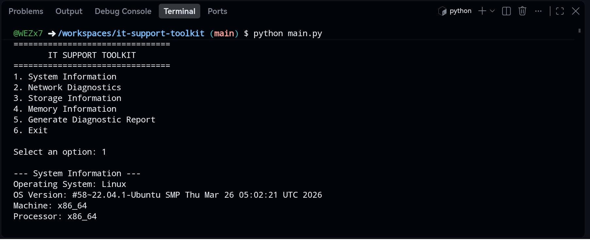
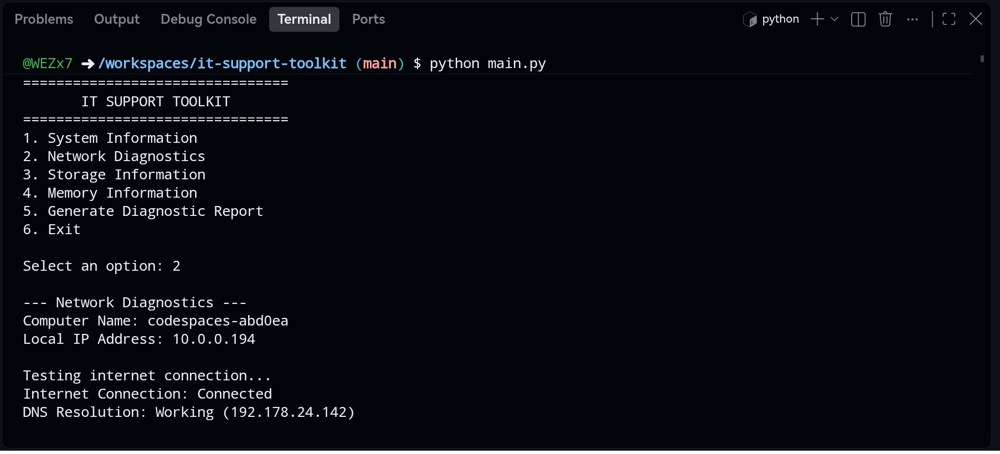
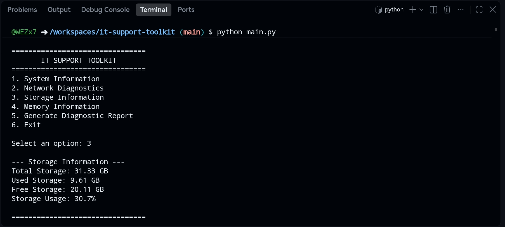
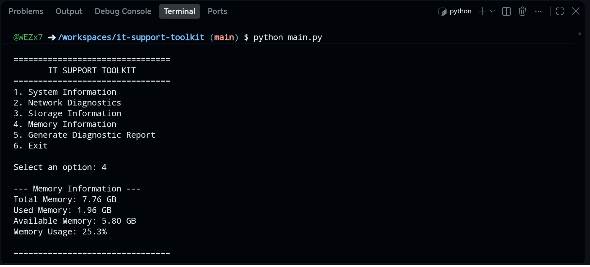
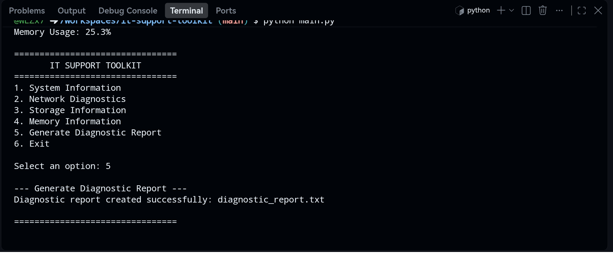

# IT Support Toolkit

A Python command-line toolkit for common IT support and system diagnostics tasks: system info, network checks, storage and memory usage, and a one-click diagnostic report.

Built with the Python standard library only, so there is nothing to install.

## Screenshots

| System Information | Network Diagnostics |
| --- | --- |
|  |  |

| Storage Information | Memory Information |
| --- | --- |
|  |  |



## Features

| Option | What it does |
| --- | --- |
| **1. System Information** | Operating system, OS version, machine architecture, processor |
| **2. Network Diagnostics** | Hostname, local IP address, internet connectivity, DNS resolution |
| **3. Storage Information** | Total, used, and free storage plus usage percentage |
| **4. Memory Information** | Total, used, and available memory plus usage percentage |
| **5. Generate Diagnostic Report** | Combines all checks into `diagnostic_report.txt` |

## Getting Started

Requirements: Python 3.

```bash
git clone https://github.com/WEZx7/it-support-toolkit.git
cd it-support-toolkit
python main.py
```

## Example

```text
================================
       IT SUPPORT TOOLKIT
================================
1. System Information
2. Network Diagnostics
3. Storage Information
4. Memory Information
5. Generate Diagnostic Report
6. Exit

Select an option: 2

--- Network Diagnostics ---
Computer Name: example-device
Local IP Address: 10.0.0.5

Testing internet connection...
Internet Connection: Connected
DNS Resolution: Working
```

## Platform Support

- System, network, and storage checks use the standard library and run on any OS with Python 3.
- Memory information currently reads `/proc/meminfo`, so it works on **Linux only**. Windows and macOS support is planned.

## Technologies

Python 3 with `platform`, `socket`, `shutil`, and `datetime`.

## What This Project Demonstrates

- System diagnostics
- Network troubleshooting
- File generation
- Command-line application design
- Basic error handling

## Planned Improvements

- Cross-platform memory information (Windows and macOS)
- CPU usage monitoring
- Additional troubleshooting checks
- Report export in other formats (JSON, HTML)

## Author

Feras M. Jubran

## License

Released under the [MIT License](LICENSE).
